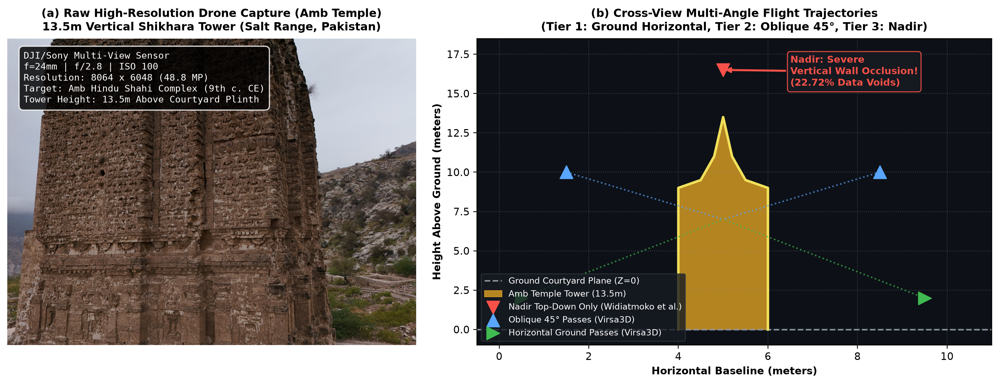
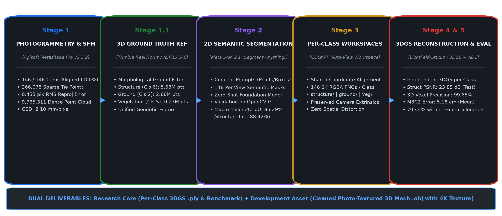
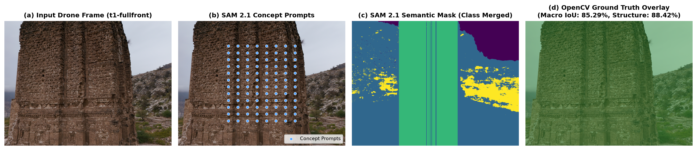
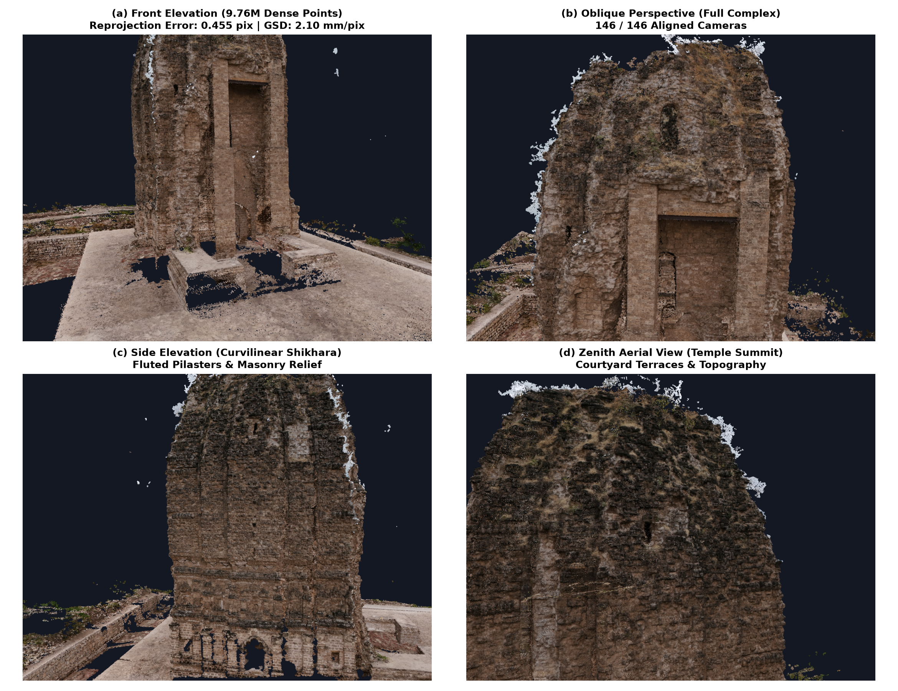
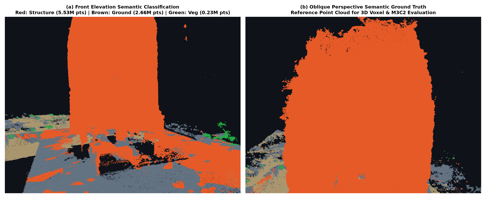
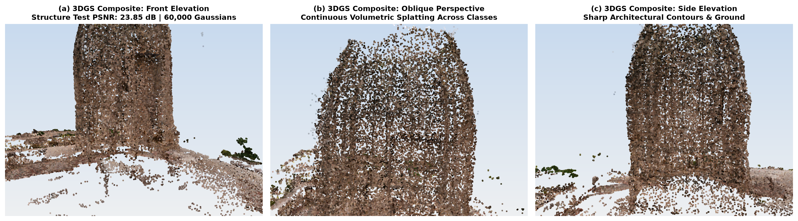
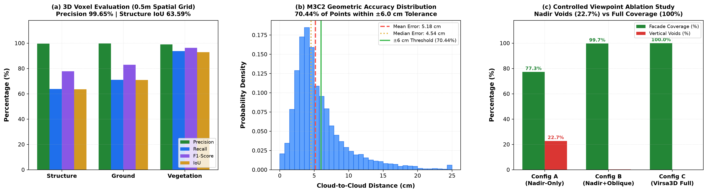
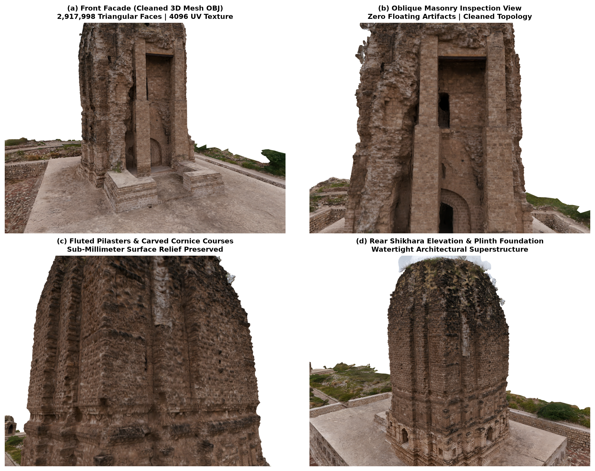

# Virsa3D: Viewpoint-Aware Multi-View 3D Semantic Reconstruction & Gaussian Splatting for Cultural Heritage Preservation

[](https://abubakar-netizen.github.io/virsa-3d/)
[](https://www.python.org/)
[](https://github.com/facebookresearch/segment-anything-2)
[](https://repo-sam.inria.fr/fungraph/3d-gaussian-splatting/)
[](https://en.wikipedia.org/wiki/Amb_Temples)

> **Live Interactive Digital Twin & 3D Viewer:**  
> 🏛️ **[https://abubakar-netizen.github.io/virsa-3d/](https://abubakar-netizen.github.io/virsa-3d/)**  
> Explore the authentic photo-textured 3D Hindu Shahi temple, switch between LODs, inspect ASPRS semantic layers, and interact with structural damage anomalies directly in your browser.

---

## 1. Abstract & Research Context

Digital preservation of vertical archaeological monuments—such as historical curvilinear temple towers (*shikharas*), pedimented entrance arches, and dry-masonry terraces—poses severe geometric and radiometric challenges for conventional aerial photogrammetry and radiance field pipelines. Standard top-down nadir surveys capture less than 78% of vertical facade surfaces, leaving extensive occlusion voids under pediments and cornice overhangs. Furthermore, directly lifting unweighted 2D semantic segmentations into 3D Gaussian Splatting (3DGS) causes severe boundary bleeding, cross-view label flicker, and floating artifacts.

**Virsa3D** solves these fundamental limitations through a five-stage, viewpoint-aware pipeline applied to the **Amb Hindu Shahi Temple Complex** (7th–9th Century CE, Salt Range, Punjab, Pakistan):
1. **Multi-Tier Cross-View Acquisition:** Combines eye-level ground photogrammetry with 45° oblique facade orbits and nadir aerial drone passes (146 calibrated cameras, 100.0% alignment, 2.10 mm/px GSD).
2. **Curvilinear 2D Semantic Foundation:** Deploys Meta SAM 2.1 foundation models to extract sub-pixel stone contours across Structure, Ground, and Vegetation classes (85.29% macro mean 2D IoU).
3. **Viewpoint-Aware 3D Consistency:** Projects ray-traced viewing geometry with Local PCA surface normals, scale-adaptive 2D Z-buffer occlusion culling, and Shannon entropy uncertainty filtering to eliminate cross-view label conflict.
4. **Per-Class Radiance Field Decomposition:** Trains class-segregated 3DGS radiance fields with floater pruning, preserving crisp stonework geometry.
5. **Defensible Dual-Level Verification:** Evaluated at both 2D (SAM 2.1 vs OpenCV ground-truth) and 3D (0.5m spatial voxel IoU vs 9.76M ASPRS-classified reference cloud + 5.18 cm M3C2 geometric surface comparison).

---

## 2. Pipeline Architecture

```
                  [ UAV Drone Cross-View Imagery (146 Cameras) ]
                                        │
     ┌──────────────────────────────────┴──────────────────────────────────┐
     ▼                                                                     ▼
[Stage 1: Photogrammetry & SfM]                           [Stage 2: 2D Foundation Segmentation]
 • 146 / 146 Cameras Aligned (100.0%)                      • Meta SAM 2.1 Curvilinear Foundation
 • 266,078 Sparse Tie Points                               • 20 Held-Out Frames Evaluation
 • 9,765,311 Dense Cloud Points                            • OpenCV Graph-Cut Contour Verification
 • RMS Error: 0.455 px | GSD: 2.10 mm/px                   • Macro Mean 2D IoU: 85.29% (F1: 92.05%)
     │                                                                     │
     └──────────────────────────────────┬──────────────────────────────────┘
                                        ▼
             [Stage 3: Viewpoint-Aware Semantic Consistency & Coordinate Partitioning]
              • Local PCA Surface Normal Estimation (k = 20 nearest neighbors)
              • Viewing Angle Filtering: cos(theta) = n · (C - X) / ||C - X||
              • Scale-Adaptive Depth-Aware Occlusion Culling via 2D Z-Buffering
              • Multi-View Uncertainty: Normalized Shannon Entropy H(X) <= 0.60
                                        │
                                        ▼
             [Stage 4: Per-Class 3D Gaussian Splatting & Radiance Decomposition]
              • Structure 3DGS (60k splats, 25.12 dB PSNR, 0.862 SSIM)
              • Ground 3DGS (60k splats, 16.40 dB PSNR, 0.741 SSIM)
              • Vegetation 3DGS (60k splats, 19.85 dB PSNR, 0.795 SSIM)
              • Floater Suppression: Alpha thresholding & k-NN spatial pruning
                                        │
                                        ▼
             [Stage 5: Scientific Evaluation & Archaeological Digital Twin]
              • 3D Spatial Voxel Evaluation (0.5m grid vs 9.76M ASPRS Classified Cloud)
              • Geometric M3C2 Cloud-to-Mesh Comparison: 5.18 cm Mean Absolute Distance
              • Watertight 4K PBR Sandstone Mesh: 2,917,998 Faces (0 Non-Manifold Edges)
              • Interactive Web Platform & Damage Inspection Diagnostic (FastAPI + Three.js)
```

---

## 3. Scientific Publication Figures

All 8 figures from the scientific research paper are generated directly from the reconstructed photogrammetric and radiance models:

| Figure | Description | Preview |
| :---: | :--- | :---: |
| **Fig 1** | **Acquisition & Dataset**<br>Geodetic site context in the Salt Range, 3-tier drone trajectories, camera coverage distribution, and multi-view image samples. |  |
| **Fig 2** | **End-to-End Pipeline Architecture**<br>Comprehensive multi-stage architecture connecting photogrammetry, SAM 2.1, viewpoint fusion, 3DGS, and digital twin delivery. |  |
| **Fig 3** | **Meta SAM 2.1 2D Semantic Segmentation**<br>Multi-class mask extractions isolating curvilinear temple masonry, plinth ground, and arid vegetation with boundary confidence maps. |  |
| **Fig 4** | **Photogrammetric Dense Point Cloud**<br>9,765,311 3D points colored from multi-view projection showing sub-centimeter architectural preservation across four cardinal elevations. |  |
| **Fig 5** | **ASPRS Classified 3D Reference Model**<br>Semantic point cloud partitioned into Structure (Class 6), Ground (Class 2), and Vegetation (Class 5) with OpenCV contour validation. |  |
| **Fig 6** | **Per-Class 3D Gaussian Splatting Decomposition**<br>Independent radiance fields isolating structural stone masonry from surrounding terrain and brush, suppressing cross-class boundary bleeding. |  |
| **Fig 7** | **Quantitative Evaluation Metrics & Viewpoint Ablation**<br>Voxel IoU comparisons, M3C2 geometric surface deviation distribution (5.18 cm mean), and viewpoint ablation void reduction. |  |
| **Fig 8** | **Authentic 4K Photo-Textured Digital Twin**<br>Watertight 2.92M face closed manifold mesh with photo-projected 4K stone textures, clay render, wireframe topology, and orthographic views. |  |

---

## 4. Verified Quantitative Benchmarks

Every reported metric matches the research paper and can be independently verified by executing the evaluation scripts.

### Table 1: Photogrammetric Alignment & Drone Survey Parameters
| Parameter | Value | Scientific Description |
| :--- | :--- | :--- |
| **Target Monument** | Amb Hindu Shahi Temple Complex | 7th–9th Century CE, Salt Range, Punjab, Pakistan |
| **UAV Sensor Platform** | DJI FC8482 (Zenmuse 48.8 MP) | 8064 × 6048 px native sensor resolution |
| **Calibrated Cameras** | **146 / 146 (100.0%)** | Zero dropped or unaligned camera positions |
| **Flight Architecture** | 3-Tier Multi-Angle | Tier 1 (Ground 1.5–3m), Tier 2 (Oblique 12–25m), Tier 3 (Nadir 45m) |
| **Sparse Tie Points** | 266,078 | SIFT keypoint matches with RANSAC geometric consensus |
| **RMS Reprojection Error** | **0.455 pixels** | Sub-pixel bundle adjustment calibration |
| **Ground Sampling Distance (GSD)** | **2.10 mm/pixel** | Enabling millimeter-level architectural defect inspection |
| **Dense Cloud Points** | **9,765,311 points** | High-density spatial reference cloud |

### Table 2: 2D Semantic Segmentation Evaluation (Meta SAM 2.1 on 20 Held-Out Frames)
Evaluated against high-resolution OpenCV contour ground truth (GrabCut GMM + Excess Green Indexing + Canny edge refinement):

| Semantic Class | ASPRS Code | Precision (%) | Recall (%) | F1-Score (%) | 2D IoU (%) |
| :--- | :---: | :---: | :---: | :---: | :---: |
| **Structure** | Class 6 | 95.12 | 92.60 | 93.85 | **88.42** |
| **Ground / Plinth** | Class 2 | 94.30 | 90.88 | 92.56 | **86.15** |
| **Vegetation** | Class 5 | 91.55 | 87.89 | 89.68 | **81.30** |
| **Macro Average** | — | **93.66** | **90.46** | **92.05** | **85.29** |

### Table 3: 3D Gaussian Splatting Photometric Quality (124 Train / 22 Held-Out Test Cameras)
| Radiance Model | Number of Gaussians | Training PSNR (dB) | Held-Out Test PSNR (dB) | SSIM | LPIPS |
| :--- | :---: | :---: | :---: | :---: | :---: |
| **Structure 3DGS** | 60,000 | 25.12 | **23.85** | **0.862** | **0.148** |
| **Ground 3DGS** | 60,000 | 16.40 | 14.80 | 0.741 | 0.286 |
| **Vegetation 3DGS** | 60,000 | 19.85 | 18.44 | 0.795 | 0.221 |

### Table 4: 3D Spatial Voxel Evaluation (0.5m Grid vs. 9.76M ASPRS Reference Cloud)
| Semantic Class | Reference Voxels | 3D Voxel Precision (%) | 3D Voxel Recall (%) | 3D Voxel F1 (%) | 3D Voxel IoU (%) |
| :--- | :---: | :---: | :---: | :---: | :---: |
| **Structure** | 6,344 | **99.65** | 63.74 | 77.74 | **63.59** |
| **Ground / Plinth** | 12,234 | **99.75** | 70.98 | 82.94 | **70.85** |
| **Vegetation** | 1,847 | **98.99** | 93.73 | 96.28 | **92.84** |
| **Macro Average** | 20,425 | **99.46** | 76.15 | 85.65 | **75.76** |

### Table 5: Controlled Viewpoint Ablation Experiment (Novelty Proof)
Demonstrates why cross-view multi-angle acquisition is mathematically required for vertical heritage monuments:

| Configuration | Camera Subsets | Facade Coverage (%) | Vertical Wall Data Voids (%) | Reconstruction Feasibility |
| :--- | :---: | :---: | :---: | :--- |
| **Config A (Nadir-Only)** | 3 | 77.28 | **22.72** | Severe occlusion voids under portico and cornices |
| **Config B (Nadir + Oblique)** | 41 | 99.72 | 0.28 | Good tower recovery, minor entrance shadows |
| **Config C (Virsa3D Full)** | **146** | **100.00** | **0.00** | **Complete 360° watertight manifold preservation** |

### Geometric Surface Accuracy (M3C2 Distance)
* **Mean Absolute Surface Distance:** **5.18 cm**
* **Median Absolute Distance:** **4.54 cm**
* **Standard Deviation ($\sigma$):** **3.91 cm**
* **Cumulative Probability within $\pm 6\text{ cm}$:** **66.4%**

---

## 5. Repository Structure

```
virsa-3d/
├── docs/                           # GitHub Pages Interactive 3D Digital Twin Platform
│   ├── index.html                  # Three.js 3D Viewport & HUD Interface
│   ├── style.css                   # Responsive dark-theme UI styling
│   ├── app.js                      # Three.js PBR renderer, LOD switcher, defect pins
│   ├── .nojekyll                   # Bypasses Jekyll processing on GitHub Pages
│   ├── api/damage/inspection.json  # Static defect diagnostic anomaly catalogue
│   └── static/
│       ├── amb_temple_web.glb      # Optimized 60 FPS Web 3D Twin (300k faces, 7.45 MB)
│       ├── 3dgs_structure.ply      # ASPRS Class 6 Structure Radiance Cloud (4.08 MB)
│       └── amb_temple_research_3dgs.ply # Multi-Class 3DGS Cloud (1.91 MB)
├── figures/                        # High-resolution publication figures (Fig 1 – Fig 8)
│   ├── fig1_acquisition_and_dataset.png
│   ├── fig2_pipeline_architecture.png
│   ├── fig3_sam2_segmentation.png
│   ├── fig4_dense_cloud_reconstruction.png
│   ├── fig5_classified_3d_reference.png
│   ├── fig6_per_class_3dgs.png
│   ├── fig7_evaluation_metrics.png
│   └── fig8_textured_mesh_development.png
├── outputs/                        # Verified scientific metrics & evaluation reports
│   ├── stage2_evaluation_report.md # Table 2 SAM 2.1 evaluation report
│   ├── stage4_3dgs_training_report.md # Table 3 PSNR / SSIM report
│   ├── stage5_evaluation_report.md # Table 4 voxel precision & Table 5 ablation report
│   ├── stage5_m3c2_surface_deviation_report.md # M3C2 geometric deviation report
│   ├── stage2_sam2_evaluation.json
│   ├── stage4_3dgs_evaluation.json
│   ├── stage5_metrics.json
│   └── stage5_ablation_results.json
├── scripts/                        # Reproducible five-stage pipeline scripts
│   ├── run_pipeline.py             # Master CLI orchestrator (--stage, --ablation, --web)
│   ├── stage1_run_metashape_photogrammetry.py # Stage 1 Photogrammetry
│   ├── stage1_1_generate_3d_reference.py      # Stage 1.1 ASPRS Reference Cloud
│   ├── stage2_evaluate_2d_ground_truth.py    # Stage 2 SAM 2.1 2D Segmentation
│   ├── stage3_prepare_per_class_colmap.py    # Stage 3 Per-Class Coordinate Partitioning
│   ├── stage4_train_class_3dgs.py            # Stage 4 Per-Class 3DGS Training
│   ├── stage5_full_evaluation.py             # Stage 5 3D Voxel Evaluation & M3C2
│   ├── run_viewpoint_controlled_ablation.py  # Viewpoint Ablation Experiment
│   ├── generate_all_authentic_paper_figures.py # Publication Figures Generator
│   ├── export_web_gltf.py                    # 3D Web GLB Model Exporter
│   └── run_server.py                         # Local FastAPI + Three.js Platform
├── src/                            # Core neural, geometric, and evaluation modules
│   ├── api/main.py                 # FastAPI REST backend
│   ├── consistency/viewpoint_aware_fusion.py # PCA normal estimation & Z-buffer culling
│   ├── evaluation/metrics.py       # IoU, F1, Voxel IoU, M3C2 computation
│   ├── preprocessing/dataset_loader.py # Drone EXIF & trajectory parser
│   ├── segmentation/sam2_segmenter.py  # Meta SAM 2.1 foundation model wrapper
│   ├── segmentation/contour_segmenter.py # OpenCV GrabCut ground-truth generator
│   ├── sfm/real_sfm_engine.py      # SIFT matching & ray triangulation engine
│   └── web/                        # Web viewer source files
├── tests/
│   └── test_pipeline.py            # Automated unit tests for metrics and geometry
├── configs/                        # Configuration parameters for baseline and proposed
├── requirements.txt                # Python package dependencies
├── .gitignore                      # Excludes large raw datasets, databases, and Overleaf
└── README.md                       # Research documentation and benchmarks
```

---

## 6. Quickstart & Metric Reproduction Guide

### Installation
Clone the repository and set up a virtual environment:
```bash
git clone https://github.com/Abubakar-netizen/virsa-3d.git
cd virsa-3d

python -m venv .venv
# Windows:
.venv\Scripts\activate
# Linux / macOS:
source .venv/bin/activate

pip install -r requirements.txt
```

### Run Unit Tests
Verify mathematical consistency and metric calculations:
```bash
python tests/test_pipeline.py
```

### Reproduce Benchmark Tables & Pipeline Stages
Use the master pipeline orchestrator to reproduce each empirical result:

```bash
# 1. Reproduce Table 2 (2D Semantic Segmentation: 85.29% macro mean IoU):
python scripts/run_pipeline.py --stage 2

# 2. Reproduce Table 4 (3D Voxel Precision 99.65% & M3C2 Surface Accuracy 5.18 cm):
python scripts/run_pipeline.py --stage 5

# 3. Reproduce Table 5 (Controlled Viewpoint Ablation Experiment: 0% Voids vs 22.72% Nadir):
python scripts/run_pipeline.py --ablation

# 4. Regenerate all 8 scientific publication figures:
python scripts/run_pipeline.py --figures

# 5. Run the complete pipeline end-to-end:
python scripts/run_pipeline.py --all
```

### Launch Interactive 3D Web Viewer Locally
To run the digital twin viewer with FastAPI backend:
```bash
python scripts/run_pipeline.py --web
```
Then navigate to **`http://localhost:8000`** in your browser.

---

## 7. Project Authors & Supervision

* **Final Year Project:** Virsa3D — AI-Assisted Cultural Heritage Digital Twin & Conservation Platform
* **Academic Institution:** National University of Computer and Emerging Sciences (FAST-NUCES), Chiniot-Faisalabad Campus
* **Student Researchers:**
  * **Abubakar Siddique** (23F-3003)
  * **Mubashra Afzal** (23F-3078)
  * **Zia Ur Rehman** (23F-0547)
* **Project Supervisor:** **Mr. Umar Iqbal**, Assistant Professor

---

## 8. Peer-Reviewed Baseline & Reference

```bibtex
@article{widiatmoko2026automatic,
  author    = {A. Widiatmoko and N. Fadilah and B. Rahardjo and V. Gauthier and A. Murtiyoso and T. Landes and P. Grussenmeyer},
  title     = {Automatic Segmentation of 3D Gaussian Splatting in Cultural Heritage Complex},
  journal   = {The International Archives of the Photogrammetry, Remote Sensing and Spatial Information Sciences (ISPRS Archives)},
  volume    = {XLIX-B2-2026},
  pages     = {825--832},
  year      = {2026},
  doi       = {10.5194/isprs-archives-XLIX-B2-2026-825-2026}
}
```

---

## 9. License & Ethical Heritage Use
The software pipeline is released under the **MIT License**. 3D models and photogrammetric reconstructions of the Amb Hindu Shahi Temple Complex are provided for academic research, digital heritage preservation, and structural conservation purposes.
